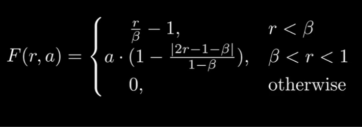

# Particle Life
It's a simulation of how forces interact with each other to simulate life-like behaviour

It uses a piecewise equation to calculate the resultant force,

## Tech-Stack
 - Cpp
 - Shaders(Fragment and Compute)
I tried to use a compute shader for parallel calculations to increase performance, but because of its small scale (for now), there isn't much performance gain visible

## Future Plans
 - Optimising the interaction of forces with Spatial-Hashing
 - Simulating with multiple particles and their interaction
 - Adding an editable UI

---

